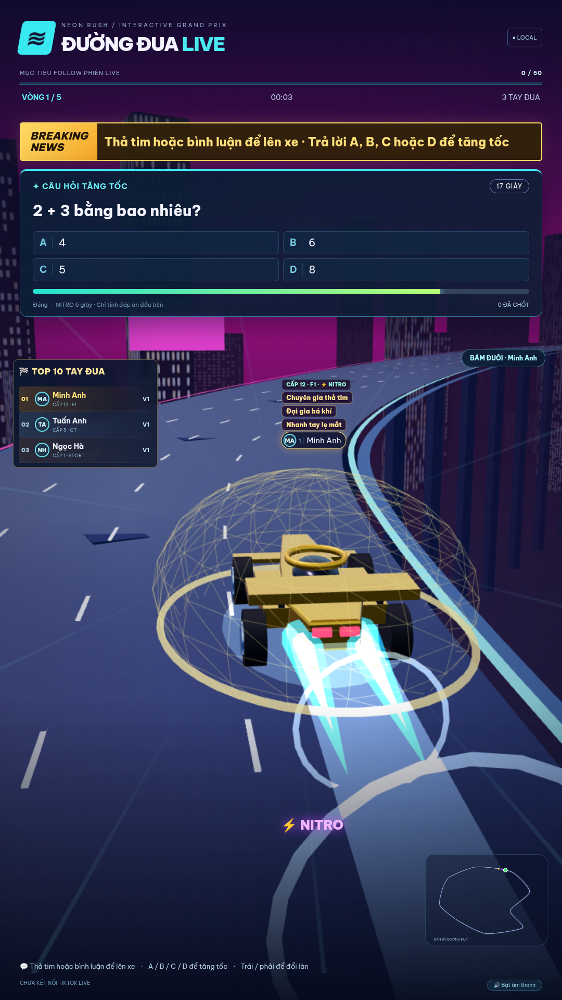
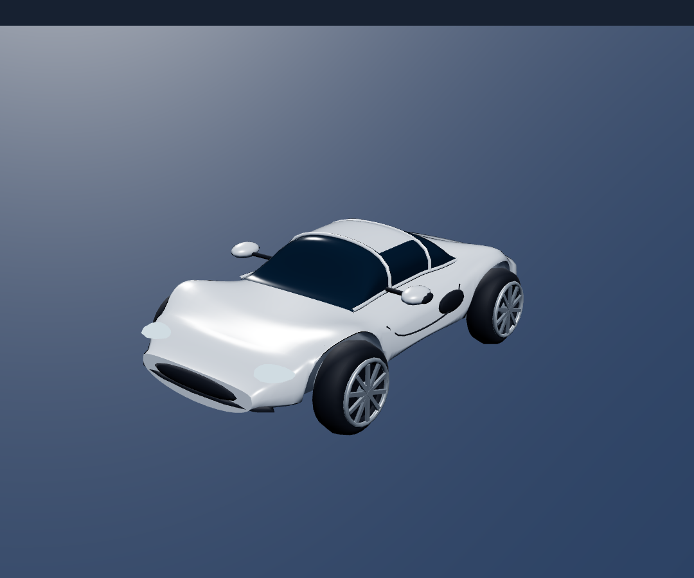
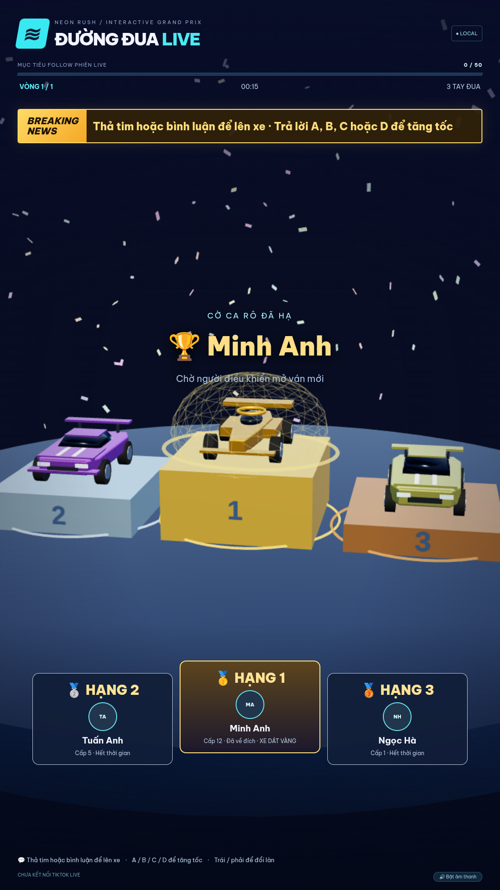

# ĐƯỜNG ĐUA LIVE — Neon Rush

Game đua xe 3D kết nối TikTok LIVE, dựng theo cơ chế và không khí hai video tham chiếu: thành phố neon, 5 vòng đua, tên/avatar trên xe, TOP 10, minimap, câu hỏi A/B/C/D để tăng tốc, quà kích hoạt nitro/khiên/tên lửa/vòng xoáy. Đây là bản game chạy thật với hình học và vật liệu tự tạo, không phát lại video hay sao chép logo/tài sản của trò mẫu.







## Chạy

Node.js 20.12+ (khuyên Node 22 LTS), Chrome/Edge hoặc OBS có tăng tốc phần cứng:

```powershell
git clone https://github.com/nepte6789/live-race-car.git
cd live-race-car
npm install
npm start
```

Vào đúng thư mục có package.json, không chạy npm ở thư mục cha. Điều khiển: http://localhost:3000/ ; màn hình đua: http://localhost:3000/overlay.html . OBS Browser Source 1080 × 1920, bật âm thanh trình duyệt. Nếu Call Country/Vua Sinh Tồn đang chạy cổng 3000, dừng ứng dụng đó hoặc tạo `.env` với `PORT=3001` rồi mở localhost:3001.

Bật 12 người thử rồi bấm **Xuất phát** để thử ngay. Đếm 5 giây trước khi xe chạy. Bấm **Bật âm thanh** trên overlay nếu muốn nhạc tự tạo và đọc câu hỏi; mặc định ưu tiên giọng nữ tiếng Việt Hoài My, An, rồi Google tiếng Việt, tốc độ 1.04 và cao độ tự nhiên. Nếu chỉ có giọng nam, ứng dụng báo thiếu giọng nữ và chờ giọng nữ được nạp. Với Windows có thể thêm tiếng Việt và tính năng Speech trong Settings → Time & language → Language & region, rồi khởi động lại trình duyệt/OBS; Chrome/Edge có thể cung cấp thêm giọng tùy máy. Có thông báo rõ nếu WebGL chưa bật; khi đó điều khiển/luật vẫn chạy nhưng không có hình 3D.

## TikTok LIVE

Nhập link hoặc @username của kênh đang LIVE ở terminal khi npm start, hoặc ở bảng điều khiển. Nhận bình luận, tim, quà, follow và người vào; tự kiểm tra/thử lại sau 2 phút khi mất kết nối. Ứng dụng chỉ nhận tương tác, không phát video hoặc gửi bình luận lên TikTok.

Nếu dịch vụ ký yêu cầu API key EulerStream, tạo `.env` cạnh package.json (được bỏ qua Git):

```dotenv
EULERSTREAM_API_KEY=key_cua_ban
TIKTOK_CHANNEL=tenkenh
PORT=3000
```

Node hỗ trợ process.loadEnvFile sẽ tự nạp `.env`; có thể dùng `node --env-file=.env server.mjs`. Không cần mật khẩu TikTok. Key ở server, không đưa vào overlay. Đã tắt tải danh mục quà mở rộng. Quyền ký kết nối phụ thuộc gói EulerStream và mạng; thêm key không tự nâng gói.

## Luật của bản dựng

- Thả tim hoặc bình luận để lên xe. Trả lời A/B/C/D có thể vừa tham gia vừa chốt đáp án. Giới hạn 100 tay đua, không đẩy người thật ra khi đủ chỗ. Tham gia giữa ván được đặt sau đoàn cuối 30 m để có thể nhập cuộc.
- Mặc định 5 vòng, mỗi vòng 2.400 m trong thang đo game. Xe tự chạy, xuất phát theo hàng bốn xe để không chồng xe lên nhau. Đúng một câu +20 XP và nitro 5 giây; chỉ tính đáp án đầu tiên. Câu mở 20 giây, công bố đáp án/giải thích 8 giây rồi sang câu. Có 24 câu khởi đầu, sửa được trong data/questions.json trước khi chạy.
- Mỗi 10 tim +1 XP và +3% năng lượng, giữ phần dư từng người. Đủ 100% tự nitro 5 giây. Bình luận NITRO/BOOST khi có 30% để dùng nitro 4 giây; trái/phải để xin đổi làn khi có khoảng trống. Xe nhanh tự tìm làn để vượt; khi bị chắn sẽ giảm tốc giữ khoảng cách. Chỉ cần 1 tim để lên xe, không cần nhắn tin.
- Follow +20% năng lượng, +10 XP, nitro 2 giây khi đang đua; chỉ tính thưởng một lần/người/ván. Mục tiêu follow hiển thị số nền do chủ LIVE đặt + follow thật nhận trong phiên, không tính người thử hoặc suy ra tổng follower kênh.
- Quà dưới 10 xu/món: nitro ngắn. Từ 10 xu: khiên 8 giây. Từ 50 xu: tên lửa làm chậm đối thủ dẫn đầu khác mình 3 giây. Từ 100 xu: thêm xoay xe 2,2 giây. Khiên chặn các đòn đó. Ngưỡng đổi được trong điều khiển, chỉ sửa luật khi ở sảnh/sau ván. Đây là quy đổi của bản dựng; video không cung cấp đủ bảng quy đổi để khẳng định trùng game gốc.
- Combo quà chỉ tính phần tăng mới, không cộng lặp khi kết thúc combo. Nitro tối đa còn 12 giây, khiên tối đa 20 giây; quà lớn không khiến xe tăng tốc vô hạn. Cấp = 1 + phần nguyên(XP/50). Cấp 5 đổi dáng GT thấp, rộng và có cánh gió; cấp 10 đổi sang xe công thức dạng F1 bánh hở, mũi dài, cánh trước/sau và khung halo. Mẫu xe tự dựng, không dùng logo hãng.
- Người đầu tiên hoàn thành đủ vòng thắng. Những người khác có thêm tối đa 15 giây, sau đó chốt thứ tự người đã về đích trước, rồi quãng đường của người chưa về đích. Tự mở ván sau 12 giây nếu bật, giữ danh sách người tham gia và số lần thắng; giữ XP/cấp, tim và thống kê quà trong phiên; năng lượng/tiến độ/thời gian trả lời tính lại. Người dẫn đầu được dát vàng và hào quang, top 3 có bục trao giải 3D sau ván.
- Người thử là dữ liệu nội bộ, tự trả lời/thả tim/quà; không tạo tương tác hay người xem trên TikTok. Có nút xóa riêng người thử, giữ người thật.

Bản đồ nhỏ và vị trí xe dùng cùng đường cong 3D; thời gian, tốc độ, vòng, đáp án, thứ hạng và hiệu ứng được chốt trên server. Mặc định camera tự đổi cảnh mỗi 8 giây giữa đầu, giữa, cuối đoàn, góc trước, bên hông và toàn cảnh; các lượt sau chọn tay đua khác. Có thể chọn bám đuôi/toàn cảnh trong điều khiển; quà được ưu tiên cận cảnh 5 giây. Tên/avatar người thật lấy từ sự kiện TikTok, có chữ viết tắt dự phòng.

## Danh hiệu trên xe

- **Chuyên gia thả tim**: người có tổng tim nhận được cao nhất trong phiên; bằng nhau ưu tiên người vào trước.
- **Đại hiệp tặng quà**: từ 10 món quà trong phiên, combo chỉ tính phần tăng mới.
- **Đại gia bá khí**: đã tặng ít nhất một món trị giá từ 100 xu/món (không gộp nhiều quà nhỏ thành một quà lớn).
- **Nhanh tay lẹ mắt**: tổng thời gian trả lời đúng thấp nhất trong ván sau khi chốt câu. Sai hoặc không trả lời cộng đủ 20 giây (theo thời lượng câu đã cài); người vào muộn cũng chịu thời gian các câu đã bỏ lỡ. Phải có ít nhất một câu đúng. Thời gian tạm dừng không được tính.

Tên/avatar trên xe có bảng tên phát sáng và huy hiệu với viền nguyệt quế. Cấp xe hiển thị màu xanh theo bậc Tân binh/Cao thủ/Huyền thoại; danh hiệu nằm trên các dải màu riêng (tim, quà, quà lớn, trả lời nhanh). Huy hiệu dẫn đầu dùng vương miện; các thành tích khác dùng biểu tượng phù hợp. Các cụm tên tránh chồng nhau và tránh che câu hỏi.

Có thể có nhiều danh hiệu cùng lúc. Đáp án đúng chỉ được tô đậm/xanh sau khi hết giờ, ba đáp án khác mờ đi. Thanh màu dưới đáp án thu ngắn theo thời gian còn lại; 5 giây cuối chuyển đỏ. Overlay bỏ khung chat và đồng hồ tốc độ/năng lượng để dành chỗ cho cảnh đua. Hướng dẫn tham gia nằm ngay dưới Breaking News trong dải màu riêng. Thông báo nổi phía dưới đã bỏ để không lặp bản tin; lời đọc và hiệu ứng quà vẫn giữ. Bảng top 10 gọn thành một dòng/người, có tên/avatar, cấp và vòng/trạng thái về đích. Nitro vẫn hoạt động với lửa đôi, lõi sáng, vệt dài, vòng sóng và góc nhìn mở rộng. Tốc độ cơ bản 64 m/s trong thang đo game; nitro cộng 38 m/s, vẫn giảm tốc nếu làn trước bị chắn.

## Hình ảnh / giới hạn

SPORT/GT dùng thân xe cong có vòm bánh, kính cong, nóc và viền kính, gương, đường viền cửa, hốc gió, lốp tròn và mâm mười chấu. SPORT bỏ cánh gió lớn; GT/F1 giữ cánh gió theo cấp. Thân và hốc gió F1 cũng được làm mềm lại. Các mẫu xe tự dựng từ hình học dùng chung, không tải model từ bên ngoài.

Three.js dựng đường đua khép kín trên cao, nhà cửa, cửa sổ, xe và khiên từ hình học thủ tục; không cần API bản đồ hay tải asset ngoài trong lúc LIVE. Xe và tòa nhà dùng instancing để giảm draw call. Hiệu ứng và vật lý là arcade, không phải mô phỏng giao thông thực. Không có cược, tiền thưởng hoặc đổi điểm ra tiền.

Font Be Vietnam Pro: SIL OFL, giấy phép kèm trong public/assets/fonts/OFL.txt. Three.js: MIT, giấy phép trong gói npm. Nhạc Web Audio tự tạo “Neon Sprint”, EDM vui tươi 128 BPM với kick bốn phách, bass offbeat, clap, hi-hat và giai điệu sáng; có đoạn tăng năng lượng và chuyển nhịp. Âm lượng nền mặc định 10%, tự hạ còn 16% mức đó khi đang đọc; compressor kiểm soát đỉnh âm. Không dùng bản thu hoặc sample từ video mẫu. Cần máy có WebGL; độ mượt thực tế tùy GPU và phần mềm quay LIVE. Khung dựng nội bộ 720 × 1280 rồi co theo overlay 1080 × 1920.

## Kiểm tra

```sh
npm test
```

Luật được kiểm tra bằng Node; giao diện được kiểm tra trong Chromium. Việc chạy mô phỏng không thay thế kiểm tra một kênh TikTok đang LIVE. Server chỉ lắng nghe 127.0.0.1, kiểm tra Host/Origin, overlay nhận trạng thái nhưng không có quyền gửi lệnh điều khiển. Không phục vụ `.env` ra HTTP.

Bản kiểm tra hiện tại: 32 kiểm thử luật/hình học/giọng đọc đạt, gồm cấp xe, danh hiệu, thời gian trả lời có tạm dừng, góc máy và 100 xe giữ khoảng cách. Chromium kiểm tra các dáng SPORT/GT/F1, công bố đáp án và bục trao giải; đã kiểm tra khiên/tên lửa, pause/resume, chuyển góc máy, xóa mô phỏng, overlay không điều khiển được server và `.env` không được phục vụ. Đã thử cả trường hợp không có WebGL để hiện hướng dẫn thay vì trang trống. Chưa xác nhận kết nối với một phiên TikTok LIVE thật.
